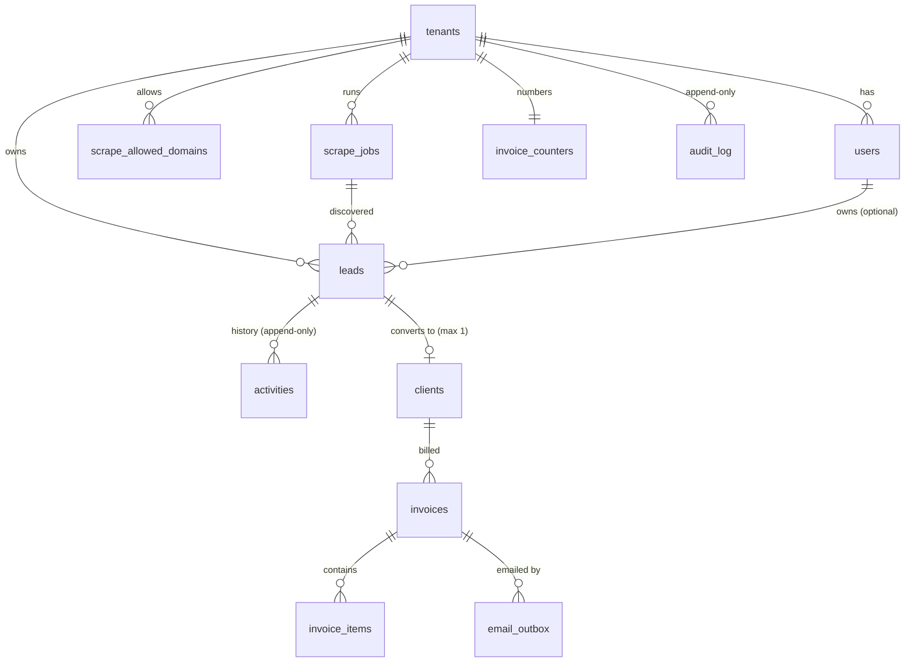

# Web app: PostgreSQL schema

Migration: `server/migrations/001_core.sql` (forward-only, checksummed, run by `npm run db:migrate`).
Derived from the Phase 1 design (`phase1/docs/02-schema-spec.md`, branch `Phase-1`), translated from 7 Mongo
collections into relational tables, with the improvements a real RDBMS allows.

## Entity relationships

## How tenant isolation is enforced (three independent layers)

1. **Application**: every query filters `tenant_id`, and the tenant comes from the authenticated session, never the request body.
2. **Composite foreign keys**: every reference is `(tenant_id, x_id) -> parent(tenant_id, id)`. A lead cannot be owned by
   another tenant's user, a client cannot point at another tenant's lead, an invoice cannot bill another tenant's client.
   This holds even for the schema owner, because it is a constraint, not a permission.
3. **Row-Level Security**: the app connects as `apex_app` (no superuser, no BYPASSRLS, not the table owner). Each request runs in a
   transaction that does `set_config('app.tenant_id', ..., true)`; policies hide every other tenant's rows and reject writes for
   another tenant. The API refuses to start if its role could bypass RLS.

## What the database guarantees on its own

| Rule | Mechanism |
|---|---|
| One client per lead (retried conversion is harmless) | `UNIQUE (tenant_id, lead_id)` |
| One invoice / one e-mail per business fact | `UNIQUE (tenant_id, idempotency_key)` |
| No duplicate scraped leads per tenant | partial unique index on `(tenant_id, dedupe_key)` |
| A CLOSED_WON lead always has a client, and is final | `CHECK` + trigger |
| Invoice `total = subtotal + tax`; issued invoices have a number | `CHECK` |
| Gapless per-tenant invoice numbers | counter row locked and bumped in the issuing transaction |
| History cannot be rewritten | `activities`, `audit_log`: UPDATE/DELETE revoked from the app role **and** blocked by trigger |
| Concurrent edits | `version` column; `UPDATE ... WHERE id = $1 AND version = $2` (10 racing writers: exactly 1 wins, tested) |
| Workers never double-claim an e-mail | `SELECT ... FOR UPDATE SKIP LOCKED` (tested with 4 racing workers) |
| Live updates | `AFTER INSERT/UPDATE` triggers `pg_notify('apex_changes', {tenant, entity, id, op})`, delivered only on commit, ids only |

Money is integer paise (`bigint`), tax is basis points. Soft deletes (`deleted_at`) on tenants, users, leads, clients, invoices.
