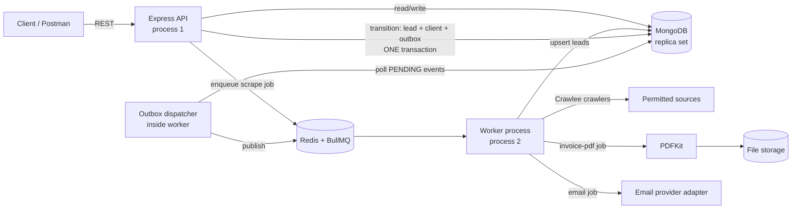

# 01 - Architecture

**Project:** ApexOutbox - lead scraping, sales pipeline, and reliable client onboarding
**Phase:** 1 (Architecture & foundation)
**Why "Outbox":** the core DBMS idea of the project is the *transactional outbox pattern*. When a lead
becomes Closed-Won, the client record and the "send invoice" event are saved in one database transaction,
so the system can never end up with a client but no invoice job (or the reverse).

## 1. Scope (confirmed for Phase 1)

| Question | Decision |
|---|---|
| Who uses it first? | Internal use, one business. |
| Will it be hosted for others? | Possibly later. Every document carries a `tenantId` from day 1, but there is only one tenant and no tenant-management UI in this project. |
| Payments? | Out of scope. Invoices are generated and emailed; marking PAID is manual. |
| Scraping? | Crawlee, one permitted source adapter in Phase 2. |

## 2. Component diagram

Two processes, one codebase: `src/server.ts` (API) and `src/worker.ts` (background jobs).
The API stays fast because it never scrapes, renders PDFs, or calls the email provider.

## 3. Core workflow

1. User calls `POST /api/scrape-jobs`. A `ScrapeJob` row is created (QUEUED) and a BullMQ job is added.
2. Worker runs the Crawlee adapter. Each record is normalised, validated, deduplicated, and upserted into `leads`
   with source provenance (adapter, URL, time, job id).
3. Users move leads through the pipeline with `POST /api/leads/:id/transitions` (expected version required).
4. On **CLOSED_WON**, one transaction does: update lead (status, version+1, clientId) + insert Client + insert Activity +
   insert OutboxEvent `LEAD_CONVERTED`.
5. The outbox dispatcher publishes PENDING events to BullMQ, then marks them PUBLISHED.
6. The onboarding worker creates (or fetches) the single invoice for that conversion, renders the PDF from an
   immutable snapshot, stores it, then sends the email and records the provider's message id and outcome.

## 4. Why this design survives failures

| Failure | What happens |
|---|---|
| API crashes after commit, before queueing | Outbox row is already saved as PENDING; the dispatcher picks it up. Nothing lost. |
| Redis is down | Events stay PENDING in MongoDB; dispatcher retries with backoff when Redis returns. |
| Same event published twice | Worker uses the event's idempotency key; unique indexes make creating a second client/invoice impossible. |
| Two users edit the same lead | Second request carries a stale `version` and gets `409 VERSION_CONFLICT`. |
| Email request times out | Outcome is *uncertain*: mark `SEND_UNCERTAIN` and reconcile with the provider by message id; never blindly resend. |
| Scraper site changes layout | Each source is its own adapter with fixture-based parser tests; a broken adapter fails one job, not the system. |

## 5. Tenant boundary approach

- Every collection has `tenantId` (required) and every index starts with `tenantId`.
- Every repository/service function takes `tenantId` as its first argument; there is no query helper that omits it.
- Phase 1 seeds one tenant (`internal`). Phase 5 adds isolation tests only if shared hosting is chosen.

## 6. Security basics fixed in Phase 1

- Environment validated at start-up (Zod); the app refuses to boot on a bad config.
- JSON body limit 100 KB; `x-powered-by` disabled.
- Secrets only from environment variables; `.env` is git-ignored.
- Authentication/authorisation design is fixed in the contracts (`actorId`, roles) and implemented in Phase 3.
- Scraper safety rules: allow-listed domains, no private/loopback IPs, redirect limits, obey robots.txt and site terms.

## 7. Technology stack

Node.js 20+ / TypeScript / Express / MongoDB + Mongoose / Zod / Redis + BullMQ / Crawlee / PDFKit / Vitest.
Reasons for each choice are in `03-decision-log.md`.
