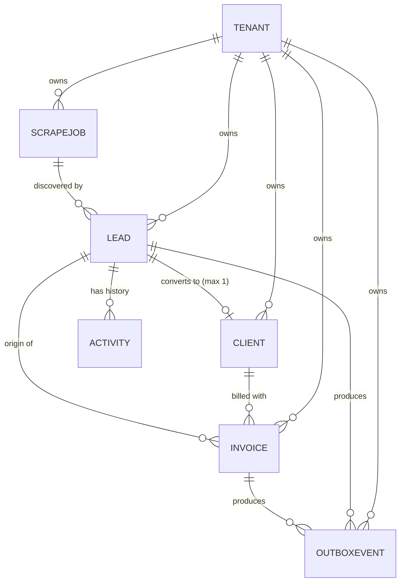

# 02 - Schema specification

The Mongoose models in `repo/src/models/` implement exactly this document.
Seven collections: `tenants`, `scrapejobs`, `leads`, `activities`, `clients`, `invoices`, `outboxevents`.

## 1. ER diagram

## 2. Collections

### tenants
| Field | Type | Notes |
|---|---|---|
| slug | string, unique | e.g. `internal` |
| name | string | |
| status | ACTIVE / SUSPENDED | |

### scrapejobs
| Field | Type | Notes |
|---|---|---|
| tenantId | ObjectId | |
| adapter | string | source adapter name |
| params | object | validated by Zod per adapter |
| status | QUEUED / RUNNING / SUCCEEDED / FAILED / CANCELLED | |
| counts | found, inserted, duplicates, rejected | all >= 0 |
| errors[] | at, message, url | bounded list |
| startedAt, finishedAt | date | |

### leads
| Field | Type | Notes |
|---|---|---|
| tenantId | ObjectId | |
| name, companyName, email, phone, website | string | trimmed; email lower-cased |
| dedupeKey | string or null | from `normalize.ts`; null => `needsReview = true` |
| status | enum of 6 | default NEW |
| version | int | optimistic concurrency counter |
| ownerId, followUpAt | | assignment and next follow-up |
| source | adapter, url, scrapedAt, jobId | provenance |
| clientId | ObjectId | set once on conversion |

### activities (append-only audit log)
| Field | Type | Notes |
|---|---|---|
| tenantId, leadId | ObjectId | |
| type | CREATED / STATUS_CHANGED / REOPENED / NOTE / OWNER_CHANGED / CONVERTED | |
| fromStatus, toStatus, reason | | reason mandatory on reopen |
| actorId, actorType | | USER or SYSTEM |
| at | date | |

### clients
| Field | Type | Notes |
|---|---|---|
| tenantId, leadId | ObjectId | unique together: one client per lead |
| name, companyName, email, phone, billingAddress, taxId | | |

### invoices
| Field | Type | Notes |
|---|---|---|
| tenantId, clientId, leadId | ObjectId | |
| idempotencyKey | string | `conversion:<leadId>`; unique per tenant |
| number | string | sequential, allocated per tenant in Phase 4 |
| status | DRAFT / ISSUED / SENT / PAID / VOID | |
| currency | string | default INR |
| items[] | description, quantity, unitAmountMinor, taxRateBp | money in **integer paise**, tax in basis points |
| totalMinor | int | |
| snapshot | object | immutable render input for the PDF |
| pdf | storageKey, sha256, generatedAt | |

### outboxevents
| Field | Type | Notes |
|---|---|---|
| tenantId | ObjectId | |
| type | LEAD_CONVERTED / INVOICE_READY_TO_SEND | |
| aggregateType, aggregateId | | which row caused it |
| idempotencyKey | string | unique per tenant |
| payload | object | see `05-event-contracts-and-state-machine.md` |
| status | PENDING / PUBLISHED / FAILED | |
| attempts, nextAttemptAt, lastError, publishedAt | | bounded retries with backoff |

## 3. Indexes and constraints (the "deliberate" ones)

| Collection | Index | Why |
|---|---|---|
| tenants | `{slug}` unique | one tenant per slug |
| leads | `{tenantId, dedupeKey}` unique, partial (dedupeKey is a string) | database-level duplicate protection; leads without identity do not collide |
| leads | `{tenantId, status, updatedAt:-1}` | pipeline board / list screens |
| leads | `{tenantId, ownerId, status}` | "my leads" filter |
| leads | `{tenantId, followUpAt}` partial | follow-up reminders |
| activities | `{tenantId, leadId, at:-1}` | lead history timeline |
| clients | `{tenantId, leadId}` unique | **at most one client per lead** |
| invoices | `{tenantId, idempotencyKey}` unique | **at most one invoice per billing event** |
| invoices | `{tenantId, number}` unique, partial | no duplicate invoice numbers |
| outboxevents | `{tenantId, idempotencyKey}` unique | an event is recorded once |
| outboxevents | `{status, nextAttemptAt, createdAt}` | dispatcher polling query |
| scrapejobs | `{tenantId, createdAt:-1}`, `{status, createdAt}` | job list and monitoring |

## 4. Embedding vs referencing

- **Embedded:** invoice line items, client billing address, lead source, scrape job counts/errors. They are always
  read with their parent and never queried alone.
- **Referenced:** activities (grow without bound), clients, invoices, outbox events (separate lifecycle and queries).

## 5. Normalisation (DBMS note)

The design is in roughly 3NF for the relational parts: a client's data lives in `clients`, not copied into every
invoice. The one deliberate denormalisation is `invoices.snapshot`: an issued invoice must keep showing the details
it was issued with, even if the client later changes their address. That is a legal/accounting requirement, not a shortcut.

## 6. Transactions and consistency

- Multi-document transactions (needs a replica set) are used for: lead conversion (lead + client + activity + outbox).
- Single-document atomic updates with a version filter (`{_id, tenantId, version}`) implement optimistic concurrency.
- Isolation: MongoDB snapshot isolation inside a transaction; write conflicts are retried (bounded) by the service layer.
- Money is integer minor units; no floating-point arithmetic on amounts.
