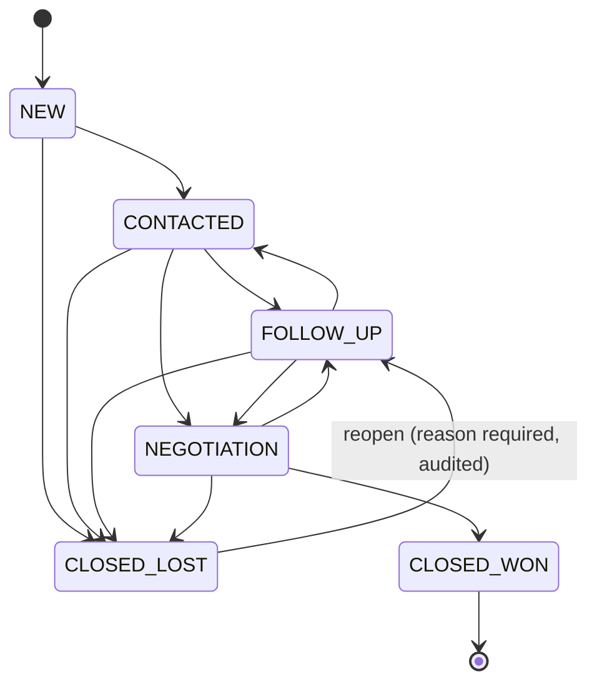

# 05 - Event contracts, state machine and idempotency

## 1. Pipeline state machine

Implemented and tested in `repo/src/domain/pipeline.ts`.



| From | Allowed to |
|---|---|
| NEW | CONTACTED, CLOSED_LOST |
| CONTACTED | FOLLOW_UP, NEGOTIATION, CLOSED_LOST |
| FOLLOW_UP | CONTACTED, NEGOTIATION, CLOSED_LOST |
| NEGOTIATION | FOLLOW_UP, CLOSED_WON, CLOSED_LOST |
| CLOSED_WON | none (final) |
| CLOSED_LOST | FOLLOW_UP via reopen only |

**Closed-Won business rules:** a lead must pass through Negotiation first; it must have a name and at least one
contact method (email or phone) so a client and invoice can be addressed; conversion happens exactly once.

## 2. Closed-Won transaction (Phase 3 implements this)

```
START TRANSACTION
  1. Lead.updateOne({ _id, tenantId, version: expectedVersion, status: from },
                    { status: CLOSED_WON, version: version+1, clientId })     -- 0 rows modified => VERSION_CONFLICT
  2. Client.insert({ tenantId, leadId, ...copied details })                   -- unique {tenantId, leadId}
  3. Activity.insert({ type: STATUS_CHANGED, from, to, actor })
  4. Activity.insert({ type: CONVERTED })
  5. OutboxEvent.insert({ type: LEAD_CONVERTED, idempotencyKey: "lead-converted:<leadId>", status: PENDING })
COMMIT   -- all five steps or none
```

## 3. Outbox event shape

```json
{
  "id": "ObjectId",
  "tenantId": "ObjectId",
  "type": "LEAD_CONVERTED",
  "aggregateType": "Lead",
  "aggregateId": "<leadId>",
  "idempotencyKey": "lead-converted:<leadId>",
  "payload": { "leadId": "...", "clientId": "...", "occurredAt": "ISO-8601" },
  "status": "PENDING",
  "attempts": 0,
  "nextAttemptAt": "ISO-8601"
}
```

Second event, created by the onboarding worker after the PDF is stored: `INVOICE_READY_TO_SEND`
with `idempotencyKey: "invoice-ready:<invoiceId>"` and payload `{ invoiceId, clientId }`.

## 4. Dispatcher algorithm

1. Find events with `status = PENDING` and `nextAttemptAt <= now`, oldest first, small batch.
2. For each: add BullMQ job with `jobId = idempotencyKey` (BullMQ ignores duplicate job ids).
3. On success set `PUBLISHED`, `publishedAt`. On error `attempts++`, `nextAttemptAt = now + backoff(attempts)`,
   store `lastError`. After 8 attempts set `FAILED` and raise an alert.
4. Safe to run twice at the same time: duplicate publishing is harmless because of the BullMQ job id and
   the consumer idempotency below.

Backoff: `min(2^attempts * 5s, 15 min)`.

## 5. Idempotency strategy (summary)

| Operation | Key | Enforced by |
|---|---|---|
| Lead ingestion | `{tenantId, dedupeKey}` | unique partial index + upsert |
| Client creation | `{tenantId, leadId}` | unique index; on duplicate-key, read the existing client |
| Invoice creation | `{tenantId, idempotencyKey = conversion:<leadId>}` | unique index; on duplicate-key, read the existing invoice |
| Outbox event | `{tenantId, idempotencyKey}` | unique index |
| Queue job | BullMQ `jobId = idempotencyKey` | BullMQ |
| Scrape job request | optional `Idempotency-Key` header | stored on the job |

## 6. Invoice and email states

Invoice: `DRAFT -> ISSUED -> SENT -> PAID`, or `VOID`. The PDF is generated from `snapshot` when moving to ISSUED.

Email attempt outcomes recorded per attempt: `ACCEPTED` (provider returned a message id), `REJECTED` (permanent
failure), `TRANSIENT_ERROR` (retry), `UNCERTAIN` (timeout or lost response). `UNCERTAIN` is never retried directly:
the reconciler asks the provider whether the message id/idempotency key was delivered, and only resends if the provider
confirms it was not.
